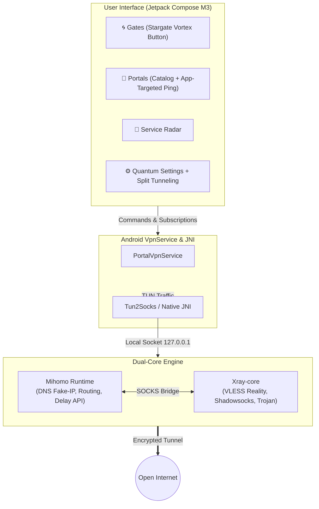
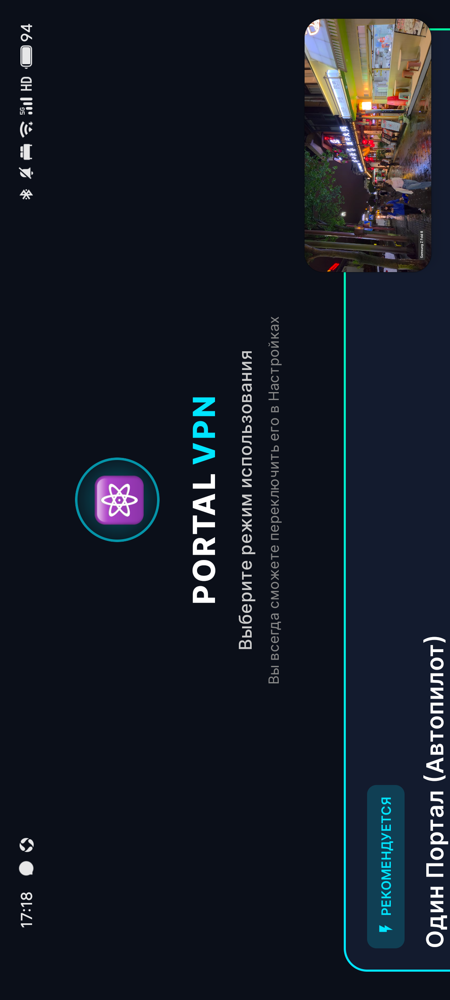
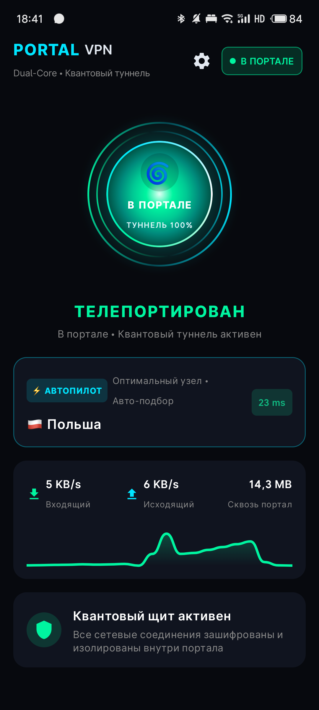
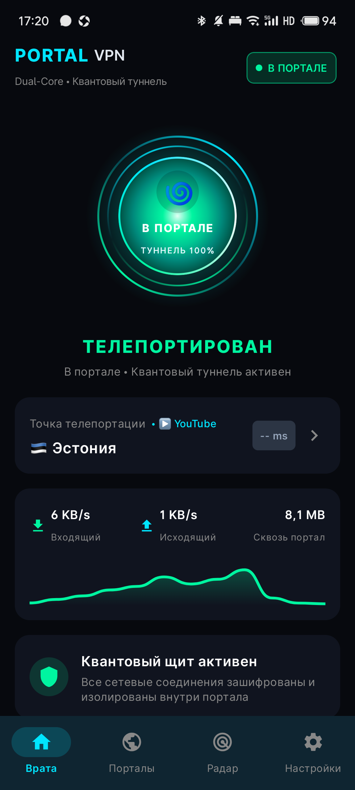
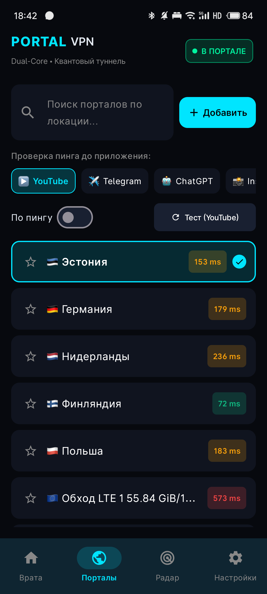
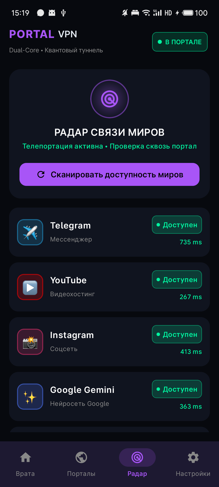
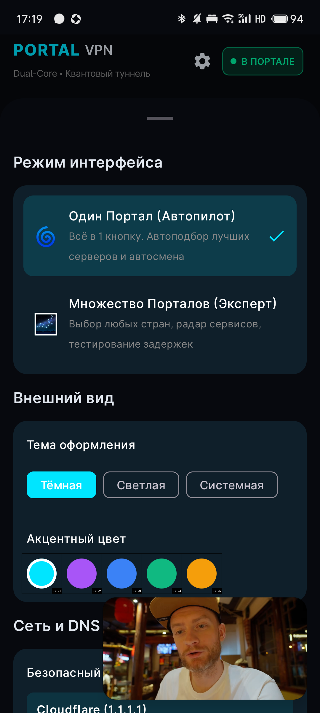

# 🌀 PORTAL VPN (Android)

<p align="center">
  <b>Quantum Tunnel through the Digital Singularity.</b><br>
  High-performance Dual-Core VPN client for <b>Android</b> built with <b>Jetpack Compose</b>, <b>Mihomo</b>, and <b>Xray</b>.<br>
  Zero in-app proxy configuration needed for Telegram or any app — open the gateway and all system traffic is secured.
</p>

<p align="center">
  
  
  
  
  
</p>

---

## 🚀 What We Achieved: Next-Gen Android Client

The project has completely evolved into a native, high-performance **Android client** centered around the **"Portal"** aesthetic while preserving its foundational superpower — the **Dual-Core Engine architecture**.

### 🌟 Key Highlights:

1. **Seamless Transparent TUN (No In-App Proxies Needed)**
   - No more manual SOCKS/HTTP proxy setups inside Telegram, browsers, or individual apps.
   - Raises an Android `VpnService` with a high-efficiency native `tun2socks` bridge that transparently routes **all OS traffic** (TCP, UDP, DNS) through the encrypted tunnel.
   - Telegram, YouTube, Instagram, ChatGPT, Gemini, and all applications work immediately upon opening the portal.

2. **Dual-Core Architecture (Xray + Mihomo)**
   - **Xray-core**: Powers cutting-edge evasion protocols (VLESS Reality, advanced transports) resistant to censorship and deep packet inspection (DPI).
   - **Mihomo (Clash Meta)**: Handles smart routing, fake-ip DNS, load balancing, and fine-grained rule matching.
   - Unified under a single, seamless user experience.

3. **Sci-Fi "Portal" Experience**
   - **"Врата" (Gateway / Home)**: Living interactive Stargate button (`PortalGatewayButton`) featuring a pulsating quantum singularity, dual counter-rotating acceleration rings, and dynamic portal states (`In the Real World` ↔ `Teleported / In Portal`).
   - **"Порталы" (Portals Catalog)**: Sci-Fi server list with instant search and favorites.
   - **App-Targeted Ping**: Select target service chips directly in the catalog (**▶️ YouTube**, **✈️ Telegram**, **🤖 ChatGPT**, **📸 Instagram**, **🌐 Google**). Measures true end-to-end proxy delay through the tunnel rather than raw TCP handshakes.
   - **Sort by Ping**: Instant one-tap sorting of all nodes by lowest latency for the chosen service.

4. **"Радар связи миров" (Service Radar)**
   - Dedicated tab providing live connectivity diagnostics to major global platforms.
   - One-tap ping scan to Telegram, YouTube, Instagram, Google Gemini, ChatGPT, and Codex directly through the active tunnel.

5. **Clean Install & Streamlined Onboarding**
   - 0 dummy or hardcoded servers on fresh install.
   - Fast import via URL, 1-tap clipboard paste 📋, or built-in QR scanner 📷.
   - Auto-detection for Portal Connect, VLESS, VMess, and Trojan subscriptions.

6. **Privacy & Security First**
   - External IP display is hidden from the UI to protect user privacy on livestreams, screen recordings, and screenshots.
   - Leak-free DNS and IPv6 protection.
   - App-level Split Tunneling to bypass the tunnel for selected local apps.
   - Android Quick Settings Tile (`VpnTileService`) for instant access from the notification shade.

7. **Automated Portal Watchdog & Failover**
   - Background health monitor tests Telegram connectivity through the active tunnel every 10 minutes.
   - If the active portal becomes unresponsive, the watchdog confirms the failure, scans available backup portals, and automatically switches both cores to the fastest responsive route with instant UI feedback.

8. **Dual Interface Mode (Auto-Pilot ↔ Expert)**
   - **«Single Portal (Auto-Pilot)»**: simplified, clutter-free experience for non-technical users. Single connect button, hidden tab bars and automated node picking.
   - **«Multi-Portal (Expert)»**: full access to all 4 tabs (Gates, Portals, Radar, Settings) with manual server selection and custom target ping tests.
   - Instant 1-tap switching between modes directly in Settings.

9. **Smart AI & Gemini Routing Engine**
   - Zero regional restrictions for **Google Gemini**, **ChatGPT**, and **Claude**.
   - Synchronized routing between `AI` and `Google / Youtube / Gemini` selector groups.
   - Dynamic health-checking across supported destinations (Germany, Finland, Netherlands, Switzerland, USA) with automated fallback when servers time out.

10. **Direct Russian Services Bypass (Zero Detection)**
    - Banking apps (Sberbank, T-Bank, VTB, Alfa-Bank), public services (Gosuslugi), VK, Yandex, and marketplaces route directly outside the VPN.
    - Two-layer isolation: OS kernel exclusion (`addDisallowedApplication`) and Mihomo L3/L7 `DIRECT` rules.

11. **In-App Self-Updater from GitHub Releases**
    - Seamless real-time release check directly inside the application.
    - Download and in-place upgrade with progress feedback.
    - Unified release signing (`portal-release.jks`) prevents package signature conflicts.

12. **Tactile Haptic Feedback & Android 17 Ready**
    - Physical tactile feedback on every interaction: portal connection, node switching, radar pings, and error alerts.
    - Full backward and forward compatibility spanning from Android 9 (API 28) up to **Android 17 (API 37)** with graceful fallback through `VibratorManager` and `VibrationEffect`.

13. **Seamless Network Handover (Wi-Fi ↔ LTE) & Interactive Notifications**
    - Dynamic `ConnectivityManager.NetworkCallback` with real-time `setUnderlyingNetworks` keeps connections alive when switching networks.
    - Interactive system notification with quick actions to switch to the next responsive portal or disconnect with one tap.

14. **Real Speedtest in Service Radar & Autopilot Priorities**
    - Live download speedtest (Mbps) via Cloudflare CDN integrated into the Service Radar.
    - Autopilot optimization presets: **🎮 Low Ping** (gaming and VoIP), **🎬 Max Speed** (4K streaming), and **🛡️ Privacy First** (neutral jurisdictions).

---

## 🏗️ System Architecture



---

## 📱 Interface Screenshots

| Mode Selection (Onboarding) | Single Portal (Auto-Pilot) | Gates (Multi-Portal) |
| :---: | :---: | :---: |
|  |  |  |
| *Intuitive mode selection on first launch* | *Single button, hidden tabs and auto node optimization* | *Living singularity, traffic counter & quantum shield* |

<br>

| Portals Catalog & Ping | Service Radar | Settings Mode Switcher |
| :---: | :---: | :---: |
|  |  |  |
| *End-to-end real delay test to YouTube, TG, ChatGPT* | *Real-time connectivity diagnostics across global services* | *Instant 1-tap interface mode switching & auto-updates* |

---

## 🛠️ Tech Stack

* **Language**: 100% Kotlin (Android API 28–35 / Android 9.0–15)
* **UI Toolkit**: Jetpack Compose, Material 3, Canvas Animations
* **Concurrency**: Kotlin Coroutines & StateFlow
* **Networking**: Android `VpnService`, `Tun2Socks`, Go JNI runtime
* **Routing Cores**: Mihomo + Xray-core
* **Subscriptions**: Portal Connect, Remnawave, VLESS Reality, Trojan, VMess

---

## 📦 Building & Running

### Prerequisites:
* **Android Studio Ladybug (2024.2+)** or newer
* **JDK 17** or **JDK 21**
* **Android SDK**: `compileSdk = 35`, `targetSdk = 34` / `35`, `minSdk = 28`
* **NDK**: 26.1+

### Build via Terminal:

```powershell
# Build Debug APK
$env:JAVA_HOME = "C:\Program Files\Android\Android Studio\jbr"
.\gradlew.bat assembleDebug

# Install on connected device via ADB
adb install -r app/build/outputs/apk/debug/app-debug.apk
```

---

## 🔒 Security & Privacy

* **Zero telemetry & logs**: The app collects no analytics, tracking, or personal data.
* **Local state**: Subscriptions, route selections, and settings reside strictly in your device's private storage.
* **Streamer-friendly**: Real external IP addresses are omitted from screens to prevent accidental leaks.

---

## 📄 License

Distributed under the [GNU General Public License v3.0 (GPLv3)](LICENSE).
Mihomo and Xray-core runtimes are licensed under their respective open-source licenses (GPL-3.0 and MPL-2.0).
