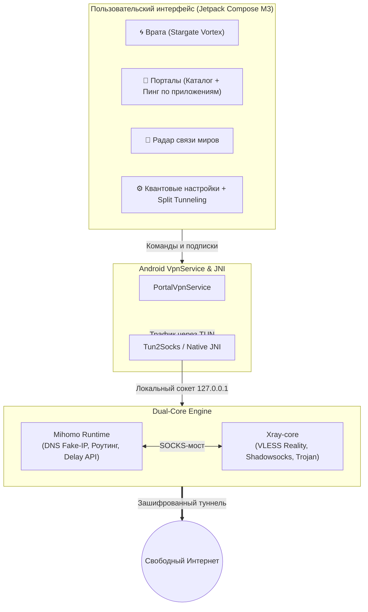
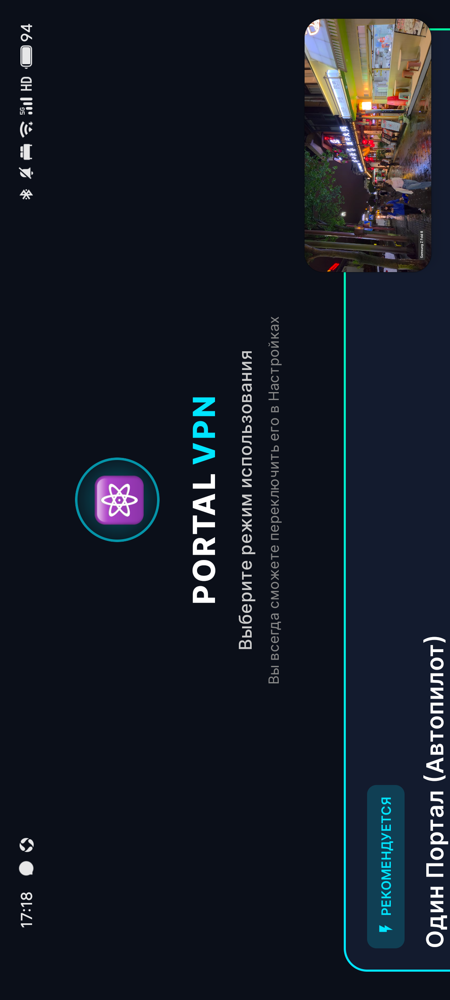
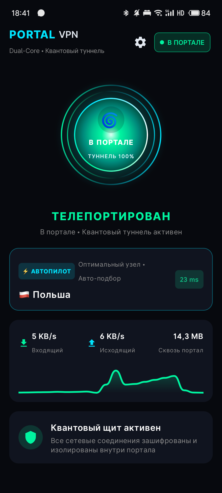
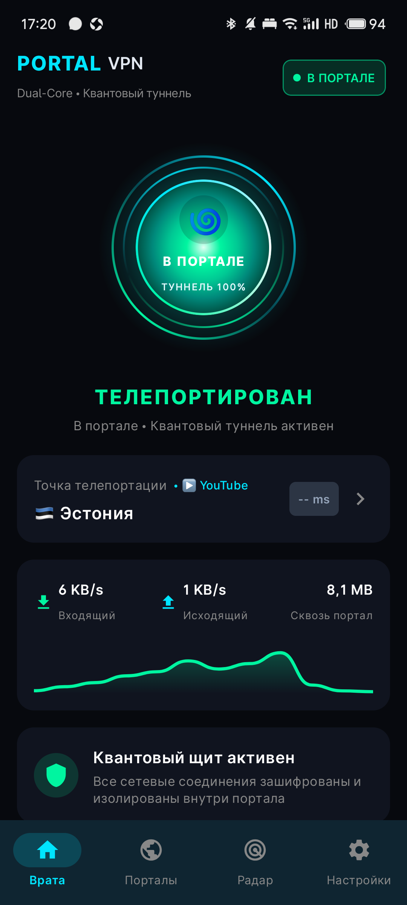
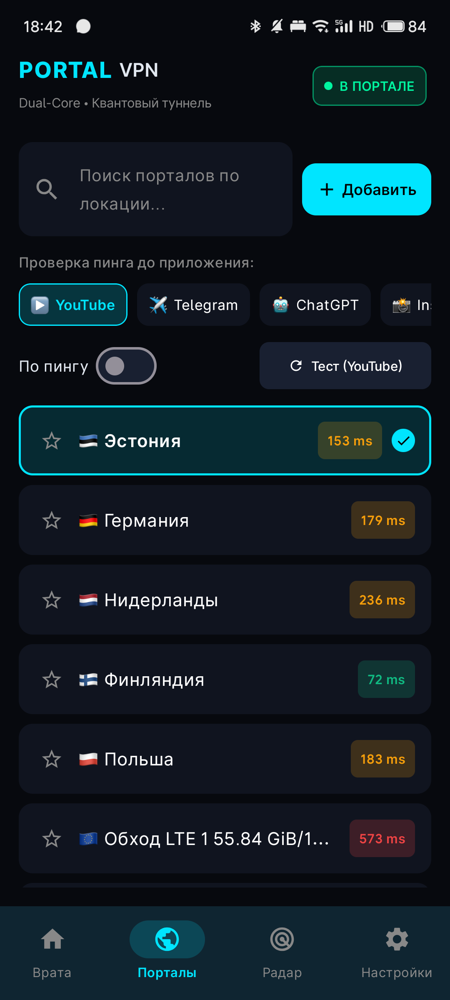
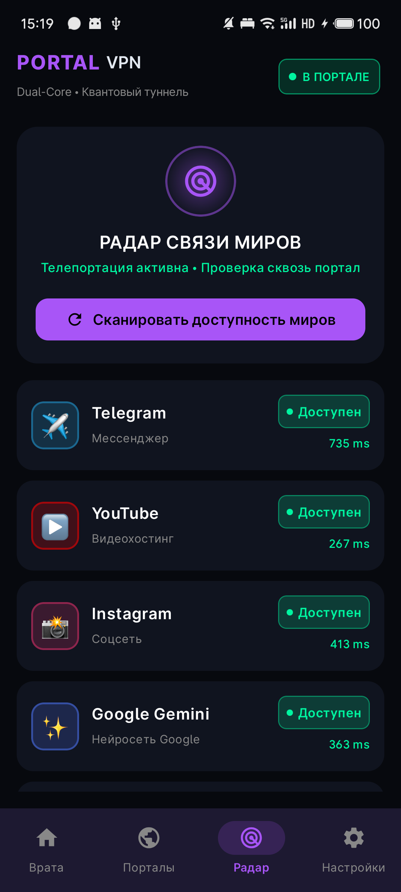
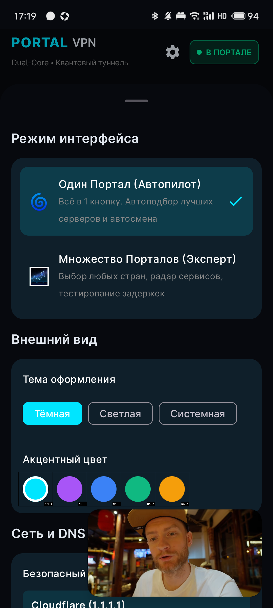

# 🌀 PORTAL VPN (Android)

<p align="center">
  <b>Квантовый туннель сквозь цифровую сингулярность.</b><br>
  Мощный двухъядерный VPN-клиент для <b>Android</b> на базе <b>Jetpack Compose</b>, <b>Mihomo</b> и <b>Xray</b>.<br>
  Никаких ручных настроек прокси в Telegram или других приложениях — вошли в портал и весь трафик защищён.
</p>

<p align="center">
  
  
  
  
  
</p>

---

## 🚀 Чего мы добились: Новое поколение клиента

Приложение эволюционировало в полноценный, нативный и высокопроизводительный **Android-клиент** с уникальной концепцией **«Порталов»** и сохранением ключевого инженерного преимущества — **архитектуры двух ядер (Dual-Core Engine)**.

### 🌟 Главные достижения:

1. **Бесшовный системный TUN (Трафик без костылей)**
   - Больше не нужно прописывать прокси в Telegram или возиться со сторонними клиентами.
   - Приложение поднимает виртуальный сетевой интерфейс (`VpnService`) и через нативный мост `tun2socks` прозрачно перенаправляет **весь системный трафик** (TCP, UDP, DNS) через зашифрованный туннель.
   - Telegram, YouTube, Instagram, ChatGPT, Gemini и другие сервисы начинают работать сразу при входе в портал.

2. **Сохранение фишки двух ядер (Dual-Core: Xray + Mihomo)**
   - **Xray-core**: отвечает за передовые протоколы маскировки (VLESS Reality, сложные транспорты), защищая от блокировок и DPI.
   - **Mihomo (Clash Meta)**: отвечает за высокоуровневую маршрутизацию, smart-DNS, балансировку нагрузки и точечные правила обхода.
   - Пользователь управляет всей мощью двух ядер одним касанием кнопки врат.

3. **Sci-Fi редизайн в концепции «Порталов»**
   - **«Врата» (Home Screen)**: Живая интерактивная кнопка-портал (`PortalGatewayButton`) с визуализацией квантовой сингулярности, вращающимися энергетическими кольцами и динамическим статусом (`В реальном мире` ↔ `Телепортирован / В портале`).
   - **«Порталы» (Servers)**: Вместо скучных списков серверов — удобный каталог квантовых порталов по странам и узлам с быстрым поиском и избранным.
   - **Умный пинг по приложениям**: Выбор целевого сервиса прямо в каталоге порталов (**▶️ YouTube**, **✈️ Telegram**, **🤖 ChatGPT**, **📸 Instagram**, **🌐 Google**). Пинг измеряется не абстрактным TCP-хэндшейком, а реальной сквозной задержкой через туннель до конкретного ресурса.
   - **Сортировка по пингу**: Мгновенное ранжирование всех доступных порталов от наименьшей задержки к наибольшей.

4. **«Радар связи миров» (Интерактивная диагностика)**
   - Отдельная вкладка со встроенным радаром доступности мировых платформ.
   - Одним нажатием проверяет отклик и блокировки до Telegram, YouTube, Instagram, Google Gemini, ChatGPT, Codex прямо сквозь активный туннель.

5. **Чистый старт и удобный импорт**
   - Никаких захардкоженных тестовых серверов при первой установке: чистый и аккуратный онбординг.
   - Быстрое добавление подписки по ссылке, вставка из буфера обмена 📋 в один клик и встроенный QR-сканер 📷.
   - Автоматическое определение протоколов Portal Connect, VLESS, VMess, Trojan.

6. **Приватность и безопасность**
   - Полностью убрано отображение внешнего IP в интерфейсе во избежание деанонимизации на стримах, скриншотах или при записи экрана.
   - Защита от утечек DNS и IPv6.
   - Раздельное туннелирование (Split Tunneling): выбор приложений, работающих в обход портала.
   - Быстрое управление из шторки уведомлений через Android Quick Settings Tile (`VpnTileService`).

7. **Автосмена портала при сбоях (Portal Watchdog & Failover)**
   - Встроенный фоновый сторож сети каждые 10 минут проверяет доступность Telegram сквозь активный портал.
   - Если сервер перестал отвечать, сторож подтверждает сбой контрольной проверкой, моментально находит среди доступных порталов самый быстрый рабочий узел и бесшовно переключает оба ядра на него, уведомляя пользователя.

8. **Двойной режим интерфейса (Автопилот ↔ Эксперт)**
   - **«Один Портал (Автопилот)»**: супер-простой режим без лишних вкладок и сложных списков. Всего одна большая кнопка включения — приложение само тестирует подписку, подбирает лучший узел и держит туннель активным.
   - **«Множество Порталов (Эксперт)»**: полный доступ ко всем 4 разделам («Врата», «Порталы», «Радар», «Настройки»), ручному выбору стран и детальным замерам задержек.
   - Быстрое переключение между режимами в Настройках в один тап.

9. **Умный шлюз для нейросетей (Smart AI & Gemini Routing Engine)**
   - Больше никаких ошибок *«Недоступно в вашей стране»* в **Google Gemini** или **ChatGPT**.
   - Автоматическая синхронизация селекторных групп `AI` и `Google / Youtube / Gemini` на единый шлюз.
   - Динамический health-check: перед выбором узел проверяется на отклик (Германия, Финляндия, Нидерланды, Швейцария, США). При падении или таймауте одного сервера шлюз автоматически перенаправляется на гарантированно рабочий.

10. **Прямой доступ к сервисам РФ (Russian DIRECT Bypass)**
    - Банки (Сбер, Т-Банк, ВТБ, Альфа), Госуслуги, VK, Яндекс, Ozon, Wildberries работают напрямую и не видят VPN.
    - Двухуровневая изоляция: системный обход ядра Android (`addDisallowedApplication`) и L3/L7 правила `DIRECT` в ядре Mihomo.

11. **Встроенное автообновление (In-App Self-Updater из GitHub Releases)**
    - Проверка наличия свежих релизов прямо в приложении при каждом запуске и в Настройках.
    - Загрузка и бесшовная установка APK в один клик без перехода в браузер.
    - Унифицированная подпись сборок (`portal-release.jks`) гарантирует чистую установку обновлений без «конфликта пакетов».

---

## 🏗️ Архитектура системы



---

## 📱 Скриншоты интерфейса

| Выбор режима (Онбординг) | Один Портал (Автопилот) | Врата (Множество Порталов) |
| :---: | :---: | :---: |
|  |  |  |
| *Выбор удобного уровня сложности при первом входе* | *Одна кнопка, скрытые вкладки и автоматический подбор* | *Живая квантовая сингулярность, счетчик трафика и статус* |

<br>

| Каталог и умный пинг | Радар связи миров | Переключатель в Настройках |
| :---: | :---: | :---: |
|  |  |  |
| *Умный замер сквозной задержки до YouTube, TG, ChatGPT* | *Диагностика отклика ключевых мировых сервисов* | *Мгновенная смена режима интерфейса и автообновления* |

---

## 🛠️ Стек технологий

* **Язык**: Kotlin 100% (Android API 28–35 / Android 9.0–15)
* **UI**: Jetpack Compose, Material 3, Canvas Animations
* **Асинхронность**: Kotlin Coroutines & StateFlow
* **Сетевой уровень**: Android `VpnService`, `Tun2Socks`, Go JNI runtime
* **Ядра маршрутизации**: Mihomo + Xray-core
* **Подписки**: Portal Connect, Remnawave, VLESS Reality, Trojan, VMess

---

## 📦 Сборка и запуск

### Требования:
* **Android Studio Ladybug (2024.2+)** или новее
* **JDK 17** или **JDK 21**
* **Android SDK**: `compileSdk = 35`, `targetSdk = 34` / `35`, `minSdk = 28`
* **NDK**: 26.1+

### Сборка через терминал:

```powershell
# Сборка Debug APK
$env:JAVA_HOME = "C:\Program Files\Android\Android Studio\jbr"
.\gradlew.bat assembleDebug

# Установка на подключенное устройство через ADB
adb install -r app/build/outputs/apk/debug/app-debug.apk
```

---

## 🔒 Безопасность и конфиденциальность

* **Без логов и телеметрии**: приложение не собирает никаких персональных данных, истории браузера или аналитики.
* **Локальная обработка**: все настройки, избранные порталы и подписки хранятся исключительно в зашифрованном хранилище вашего устройства (`DataStore / EncryptedSharedPreferences`).
* **Анти-деанон**: реальный IP-адрес намеренно скрыт из интерфейса для безопасного шеринга экрана и записи видео.

---

## 📄 Лицензия

Проект распространяется под свободной лицензией [GNU General Public License v3.0 (GPLv3)](LICENSE).
Ядра Mihomo и Xray-core распространяются под своими оригинальными открытыми лицензиями (GPL-3.0 и MPL-2.0 соответственно).
